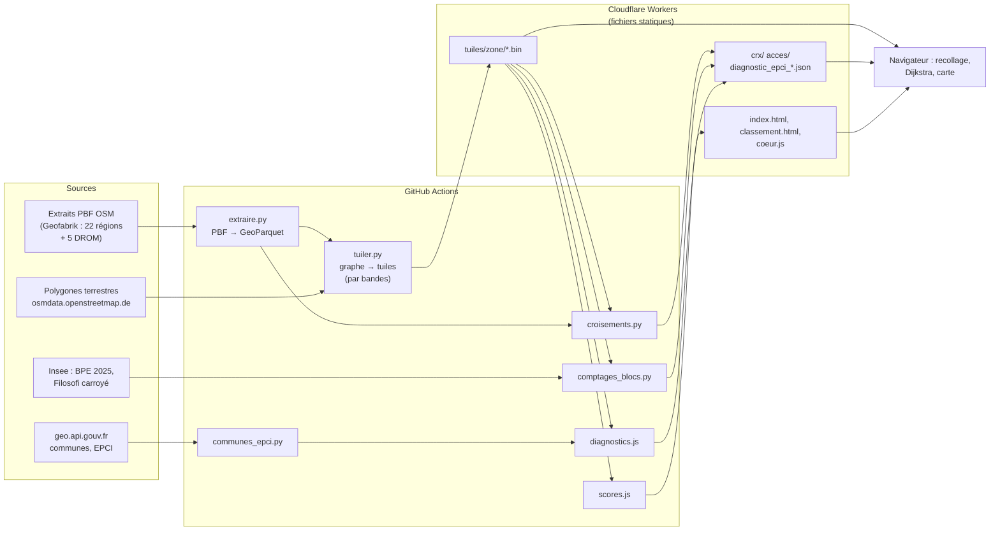
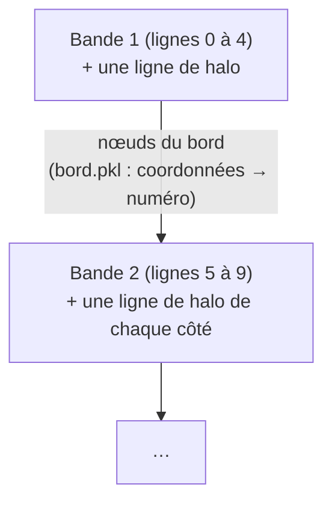
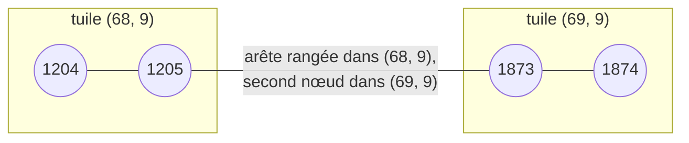
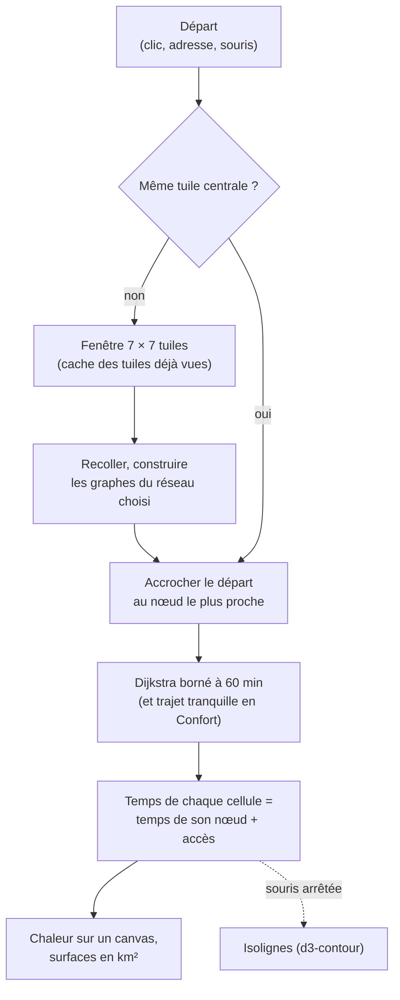
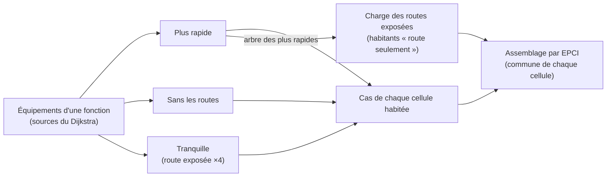
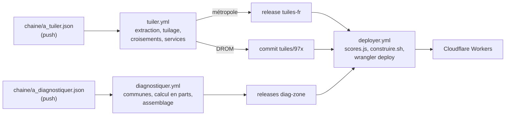

# À portée de vélo — France entière

Jusqu'où va-t-on à vélo en 15, 30 ou 60 minutes, de n'importe quel point de la France métropolitaine, de la Guadeloupe, de la Martinique, de la Guyane, de La Réunion ou de Mayotte ? Est-ce qu'on y va tranquillement, ou faut-il emprunter une route exposée ? Les habitants ont-ils l'essentiel (boulangerie, école, médecin…) à portée de vélo ?

**[portee-velo.aurelienchaumet17.workers.dev](https://portee-velo.aurelienchaumet17.workers.dev)** · [classement des départements](https://portee-velo.aurelienchaumet17.workers.dev/classement.html)

Les temps de trajet sont calculés **dans le navigateur**, à partir de fichiers statiques : pas de serveur de calcul, pas de base de données, pas d'API de routage. Le réseau vient uniquement d'OpenStreetMap ; les équipements et les habitants de l'Insee.

Ce projet dérive d'[À portée de vélo – Marennes-Oléron](https://sit-pmo.github.io/portee-velo/), lui-même inspiré d'[À portée de tram](https://tram.camilleroux.com/) de Camille Roux.

## Sommaire

1. [Ce que montre la page](#ce-que-montre-la-page)
2. [Vue d'ensemble](#vue-densemble)
3. [Le modèle : voies, vitesses, confort](#le-modèle--voies-vitesses-confort)
4. [Préparer les données](#préparer-les-données)
5. [Le format des tuiles](#le-format-des-tuiles)
6. [Le calcul dans le navigateur](#le-calcul-dans-le-navigateur)
7. [Données par blocs : croisements, services](#données-par-blocs--croisements-services)
8. [Diagnostics par intercommunalité](#diagnostics-par-intercommunalité)
9. [Le classement des départements](#le-classement-des-départements)
10. [Hébergement et calculs sur GitHub Actions](#hébergement-et-calculs-sur-github-actions)
11. [Limites connues](#limites-connues)
12. [Refaire les calculs](#refaire-les-calculs)
13. [Sources, crédits et licences](#sources-crédits-et-licences)

## Ce que montre la page

La page (`index.html`) s'ouvre sur un département de métropole tiré au sort, départ à la mairie de son chef-lieu ; le menu déroulant change de territoire (`?zone=971` pour la Guadeloupe, etc.). On déplace le départ d'un clic, en tapant une adresse, ou en le laissant suivre la souris. Quatre onglets, une question chacun :

| Onglet | Question | Ce que montre la carte |
|---|---|---|
| Portée | Jusqu'où je vais en 15 ou 30 minutes ? | Temps de trajet de chaque cellule de 100 m, isolignes 15, 30, 45 et 60 min, surface de terre atteinte |
| Confort | Est-ce que j'y vais tranquillement, et qu'est-ce qui coince ? | Teinte : bleu si le trajet tranquille coûte au plus 20 % de plus que le plus rapide, gris jusqu'à 50 %, orange au-delà ; maillons manquants ; croisements avec les routes |
| Simuler | Et si on aménageait ici ? | Tronçons de piste dessinés ou importés, et ce qu'ils changent (temps gagnés, surfaces passées au bleu) |
| Services | Les habitants ont-ils l'essentiel à portée, tranquillement ? | Habitants, ménages et équipements atteints depuis le départ ; bilan de l'intercommunalité du départ |

**Trois réseaux** au choix :

| Réseau | Voies empruntées |
|---|---|
| Avec les routes (par défaut) | Tout le réseau ouvert aux vélos ; trajet le plus rapide |
| Sans départementales et nationales | Pistes, bandes, rues, voies communales et chemins ; les départementales, les nationales et les routes principales ne sont permises que pour les traverser (au plus 80 m, giratoire compris) |
| Sans les routes | Pistes, voies vertes et bandes cyclables, reliées entre elles par de courtes liaisons (au plus 200 m de rue calme ou de chemin) |

**Corriger OpenStreetMap depuis la carte.** Le bouton « Vérifier une voie dans OpenStreetMap » montre, pour la voie cliquée, ce que la carte en a compris (classe, vitesse, sens, départementale ou nationale), ce qu'en dit OSM aujourd'hui (tags lus à la demande sur Overpass) et des indices de lecture, puis ouvre l'éditeur iD sur la voie ou une note sur osm.org. Rien n'est écrit dans OSM depuis la page : la correction reste faite par une personne (`osm-contrib.js`).

**Me localiser.** Un bouton à côté de la recherche d'adresse place le départ (ou l'arrivée) sur la position du téléphone.

## Vue d'ensemble



Point clé : **la page, les scores et les diagnostics utilisent le même code** (`coeur.js`) et les mêmes tuiles. Un départ posé sur la mairie de Rennes affiche dans la page la surface inscrite dans le classement.

## Le modèle : voies, vitesses, confort

**Quelles voies ?** Chaque voie OSM ouverte aux vélos reçoit une classe, une vitesse et un sens (`classer()` de `build_graph_velo.py`, règles de la carte de Marennes-Oléron, puis classes fines dans `tuiler.py`) :

| Classe | Voies | Confort |
|---|---|---|
| 0 — piste ou voie verte | `highway=cycleway`, ou chemin `bicycle=designated` | aménagé |
| 1 — bande | route portant `cycleway=lane`, `track` ou `shared_busway`, ou vélorue | aménagé |
| 2 — rue | `residential`, `living_street`, `service`, `road` | calme |
| 3 — route secondaire | `secondary` | très exposé |
| 4 — route principale | `primary` (et `trunk` ouvert aux vélos dans OSM) | très exposé |
| 5 — voie communale | `unclassified` | calme |
| 6 — chemin | `track`, `path`, `footway`, `pedestrian`, `bridleway` | calme |
| 7 — route tertiaire | `tertiary` | exposé |

Sont écartés : autoroutes, voies express (sauf `bicycle=yes|designated|permissive`), voies interdites aux vélos, accès privés, allées de parking, trottoirs sans autorisation explicite.

**Départementales et nationales.** Une rue ou une route dont le numéro OSM (`ref`) commence par D (ou RD) est marquée départementale, par N (ou RN) nationale. Sur les tuiles de métropole : 370 000 km d'arêtes départementales, pour environ 378 000 km de routes départementales en France.

**Vitesses.** 20 km/h sur revêtement lisse ; 13 à 17 km/h sur stabilisé ou grave, 11 à 15 km/h sur pavés, 16 km/h sur les voies partagées avec les piétons, 8 km/h sur sable. Les routes prennent 5 % de plus que les pistes, pour qu'à temps quasi égal le trajet préfère la piste qui longe la route. Un sens unique se prend à contre-sens à 5 km/h : vélo poussé à pied, plutôt qu'interdit. Ni vent ni relief.

**Le trajet tranquille.** C'est le trajet le plus court quand chaque minute sur route exposée (classes 3, 4 et 7) compte pour 4. Autour du départ (300 m), la route exposée n'est pas pénalisée : on part de chez soi par la rue qu'on a. On compare son temps à celui du trajet le plus rapide :

```
  temps tranquille ≤ max(1,2 × temps rapide, temps rapide + 1 min)   → bleu   (tranquille)
  temps tranquille ≤ 1,5 × temps rapide                              → gris
  au-delà                                                            → orange (la route est le seul chemin raisonnable)
```

## Préparer les données

### 1. Extraire d'OSM ce qui sert (`extraire.py`)

Les extraits PBF de Geofabrik (22 anciennes régions de métropole, et `guadeloupe`, `martinique`, `guyane`, `reunion`, `mayotte`) sont convertis en GeoParquet avec [QuackOSM](https://github.com/kraina-ai/quackosm) (DuckDB). On ne garde que quatre familles d'objets, avec tous leurs attributs : `highway=*` (le réseau), `amenity=townhall` (les mairies), `natural=water` (retiré de la terre), `boundary=administrative` (contours des départements et des communes).

### 2. Une grille par territoire

Chaque territoire a sa grille fixe en degrés (`TERRITOIRES` dans `format_tuile.py`) : des cellules d'environ 100 m, regroupées en tuiles de 100 × 100 cellules (environ 10 km de côté), et une projection métrique pour les distances.

| Code | Territoire | Origine (coin nord-ouest) | Projection | Tuiles |
|---|---|---|---|---|
| `fr` | France métropolitaine | -5,5° ; 51,5° | Lambert-93 (2154) | 6 281 |
| `971` | Guadeloupe | -61,9° ; 16,6° | RGAF09 UTM 20N (5490) | 90 |
| `972` | Martinique | -61,3° ; 14,9° | RGAF09 UTM 20N (5490) | 36 |
| `973` | Guyane | -54,7° ; 6,0° | RGFG95 UTM 22N (2972) | 1 428 |
| `974` | La Réunion | 55,1° ; -20,8° | RGR92 UTM 40S (2975) | 49 |
| `976` | Mayotte | 44,9° ; -12,5° | RGM04 UTM 38S (4471) | 20 |

```
   origine (lon0, lat0), coin nord-ouest
   ┌──────────┬──────────┬──────────┐
   │ tuile    │ tuile    │          │   tx croît vers l'est
   │ (67, 8)  │ (68, 8)  │   ...    │   ty croît vers le sud
   ├──────────┼──────────┼──────────┤
   │          │ 100 × 100│          │   cellule ≈ 100 m × 100 m
   │   ...    │ cellules │   ...    │   tuile ≈ 10 km × 10 km
   └──────────┴──────────┴──────────┘
```

### 3. Construire le graphe et le découper en tuiles (`tuiler.py`)

**Le graphe.** Deux voies sont reliées quand elles partagent un point au 1e-7 degré près : c'est ainsi qu'OSM représente les carrefours, alors qu'un pont qui passe au-dessus d'une route n'en partage pas. Les segments de plus de 2 km sont découpés. On garde la plus grande composante connexe, **plus toute composante d'au moins 5 km de voies** : les îles sans pont (Marie-Galante, Les Saintes, La Désirade, Yeu, Belle-Île, Ouessant, Groix…) ont leur propre réseau, tandis que les bouts isolés (allée privée, piste de parking) disparaissent.

**Les cellules.** Pour chaque cellule, la tuile stocke si c'est de la terre (polygones terrestres OSM moins les plans d'eau de plus d'un hectare), le nœud le plus proche dans le réseau avec les routes et dans le réseau sans les routes, et la distance à ce nœud. La page colore ainsi une cellule sans chercher son nœud.

**Le tuilage par bandes.** Tuiler la métropole d'un bloc demanderait environ 50 Go de mémoire (86 millions de nœuds). On la traite par bandes de 5 lignes de tuiles, en ne gardant en mémoire que la bande courante :



- chaque bande lit une ligne de tuiles de plus de chaque côté (le halo), pour voir les voies qui franchissent la limite ;
- les arêtes qui traversent vers la bande précédente appartiennent à la bande courante (retournées au besoin, sens unique compris) ; leurs nœuds déjà numérotés sont retrouvés par leurs coordonnées ;
- les cellules de la dernière ligne d'une bande attendent la bande suivante, qui peut avoir un nœud plus proche.

Contrôles : sur un réseau synthétique, tuilage d'un bloc et par bandes donnent le même graphe et les mêmes minutes (`test/bandes.test.js`) ; sur la Bretagne réelle, 5 arêtes manquantes sur 5,5 millions. Métropole : 22 minutes, 5,8 Go de mémoire, 6 281 tuiles, 86 millions de nœuds, 540 Mo.

## Le format des tuiles

Une tuile est un fichier binaire compressé (gzip), décompressé par le navigateur avec l'API native `DecompressionStream`.

```
"PVT1"                                 4 octets magiques
en-tête    version, tx, ty, base, n, m, ncx, ncy
nœuds      n longitudes, puis n latitudes (écarts successifs, en 1e-5 degré)
arêtes     m × (a, b, longueur en dm, attributs)
cellules   ncx × ncy × (terre, nœud proche × 2 réseaux, distance × 2 réseaux)
```

Les attributs d'une arête tiennent sur 16 bits :

```
 bit  15   14   13 ... 5      4  3     2  1  0
     ┌────┬────┬───────────┬───────┬─────────┐
     │ D  │ N  │  vitesse  │  sens │ classe  │
     └────┴────┴───────────┴───────┴─────────┘
      D : départementale (ref D…)   N : nationale (ref N…)
      sens : 0 double sens, 1 sens du tracé, 2 sens inverse
```

Tous les entiers sont écrits en *varint*, la plupart en **écarts** avec la valeur précédente. Les nœuds sont numérotés tuile par tuile et, dans une tuile, par carré de 1 km : deux nœuds voisins ont des numéros et des coordonnées proches, donc des écarts qui tiennent sur 1 ou 2 octets.

**Recoller les tuiles.** Chaque nœud a un numéro global unique. Une arête appartient à la tuile de son premier nœud ; son second nœud peut être dans une tuile voisine. Pour plusieurs tuiles chargées, il suffit de traduire les numéros globaux en numéros locaux : les routes qui traversent une limite de tuile ne sont pas coupées.



L'encodeur est `format_tuile.py`, le décodeur miroir `decoderTuile()` dans `coeur.js` ; un test aller-retour vérifie qu'ils restent d'accord.

## Le calcul dans le navigateur



**La fenêtre de tuiles.** Le calcul porte sur les 7 × 7 tuiles autour du départ, soit environ 70 km de côté. Aucune vitesse ne dépasse 20 km/h : en 60 minutes on parcourt au plus 20 km, et la fenêtre laisse 30 km entre la tuile du départ et son bord. Tant que le départ reste dans la même tuile, la fenêtre et les graphes sont réutilisés ; sinon on recolle une nouvelle fenêtre (les tuiles vues restent en cache) et on précharge la couronne suivante.

**Accrocher le départ.** Le départ rejoint le nœud le plus proche, à vol d'oiseau majoré de 30 %, à 16 km/h, sans dépasser 2 000 m (avec les routes) ou 800 m (sans). Sans les routes, il ne s'accroche qu'à un morceau de réseau d'au moins 1 km : pas de départ depuis un bout de piste isolé.

**Dijkstra borné.** L'algorithme de Dijkstra, avec un tas binaire, donne le temps minimal du départ à chaque nœud ; il s'arrête à la limite et ne parcourt qu'une partie de la fenêtre. Chaque tronçon donne deux arcs ; à contre-sens d'un sens unique, l'arc est à 5 km/h.

**Des nœuds aux cellules.** Le temps d'une cellule est celui de son nœud le plus proche (stocké dans la tuile) plus le temps d'accès. Les temps sont écrits directement dans les pixels d'un `<canvas>` (un pixel par cellule) que Leaflet place sur la carte.

**Simuler un aménagement.** Un tronçon dessiné devient une piste (classe 0, 20 km/h) découpée tous les 100 m et raccordée aux nœuds existants à 25 m au plus ; on calcule avant et après, et la carte montre les minutes gagnées et les surfaces passées au bleu.

## Données par blocs : croisements, services

Les croisements et les équipements ne tiennent pas dans un seul fichier à l'échelle de la France. Ils sont découpés en **blocs de 4 × 4 tuiles** (environ 40 km), et la page ne lit que les blocs qui couvrent sa fenêtre.

```
  tuiles/<zone>/crx/index.json     liste des blocs        tuiles/<zone>/acces/index.json   libellés, fonctions, sources
  tuiles/<zone>/crx/<bx>_<by>.json croisements du bloc    tuiles/<zone>/acces/<bx>_<by>.json équipements et habitants du bloc
```

**Croisements** (`croisements.py`, onglet Confort). Chaque point où une piste ou une bande croise une route : avec une départementale ou une autre route, vitesse maximale OSM (ou présumée : 50 km/h en agglomération, 80 km/h hors agglomération). Chaque bloc est traité avec une couronne d'une tuile, pour suivre les voies au bord. Métropole : 296 605 croisements, dont 27 208 avec une départementale.

**Services** (`comptages_blocs.py`, onglet Services). Pour chaque cellule de 100 m : les équipements de la Base permanente des équipements 2025 (au point géolocalisé par l'Insee), les habitants et les ménages du carroyage Filosofi (carreaux de 200 m répartis sur 4 × 4 sous-points). Neuf fonctions du quotidien ont un seuil : alimentation, boulangerie, école (15 min) ; médecin généraliste, pharmacie, poste, collège, supermarché, équipement sportif (30 min). Ces données ne sont lues qu'à l'ouverture de l'onglet Services, et les comptages ne sont faits que dans cet onglet.

| Territoire | Équipements | Habitants |
|---|---|---|
| Métropole | BPE 2025 (2,7 millions) | Filosofi 2021 (62,6 millions d'habitants) |
| Martinique, Réunion | BPE 2025 | Filosofi 2019 (carreaux en projection locale) |
| Guadeloupe, Guyane, Mayotte | BPE 2025 | pas de carroyage publié : la page le signale |

## Diagnostics par intercommunalité

Dans l'onglet Services, le bilan de l'intercommunalité (EPCI) du départ : pour chaque habitant et chaque fonction, à son seuil,

- **tranquille** : l'équipement le plus proche est atteint par les pistes, ou par un trajet bleu ;
- **route seulement** : atteint dans le seuil, mais en passant par une route exposée ; un aménagement cyclable peut y répondre ;
- **trop loin** : même par la route, au-delà du seuil ; question de service plutôt que de piste.

S'y ajoutent les communes de l'EPCI et les **maillons à aménager** : les routes exposées des trajets « route seulement », classées par habitants concernés.

Un calcul par habitant serait hors de portée (11,9 millions de cellules habitées en métropole). On calcule **à l'envers** : depuis tous les équipements d'une fonction à la fois, un Dijkstra multi-source sur le graphe transposé (sens uniques respectés) donne, pour chaque nœud, le temps jusqu'à l'équipement le plus proche.



Le calcul se fait par blocs de 4 × 4 tuiles avec une couronne d'une tuile (en 30 minutes à 20 km/h, on fait 10 km au plus), en 6 parts parallèles sur GitHub Actions (environ 5 minutes chacune). Les communes, leurs contours et leur EPCI viennent de geo.api.gouv.fr. Différence avec le panneau d'un départ : on compare les plus proches de chaque sorte (le plus rapide, le plus tranquille) au lieu d'équipement à équipement, et sans la tolérance de 300 m autour du départ ; le diagnostic est un peu plus sévère. Métropole : 1 232 EPCI ; par exemple, 88 % des habitants de la Métropole du Grand Paris ont les neuf fonctions tranquillement à vélo.

## Le classement des départements

`classement.html` colore les 96 départements de métropole et les 5 DROM (en encarts) par la **surface de terre atteinte en 15 minutes** depuis la mairie du chef-lieu, avec ou sans les routes. Les DROM partent de la mairie de leur commune la plus peuplée (en Guadeloupe, Les Abymes plutôt que Basse-Terre).

Pourquoi une surface ? Elle résume à la fois la densité du réseau, sa continuité et ses obstacles (fleuves sans pont, voies rapides, impasses). Le plafond théorique est le disque parcouru à 20 km/h en ligne droite : 5 km de rayon, soit 78,5 km². La mer et les plans d'eau ne comptent pas : un chef-lieu côtier n'est pas pénalisé pour la mer qui l'entoure.

`scores.js` fait tourner sous Node exactement le code de la page (fenêtre de 3 × 3 tuiles, Dijkstra borné à 15 minutes, aire de chaque cellule calculée à sa latitude). En tête avec les routes (données OSM d'octobre 2026) : Paris 48,6 km², Rennes 46,9, Niort 46,5, Bordeaux 46,3. Sans les routes, Paris (35,1) et Rennes (32,2) restent devant ; plusieurs chefs-lieux n'ont aucune piste à portée de la mairie. La carte répartit les départements en classes d'effectifs égaux (quantiles), recalculées pour chaque réseau.

**Toutes les communes.** `scores_communes.js` refait le même calcul depuis la mairie de chacune des 34 875 communes (positions de geo.api.gouv.fr). Le classement propose alors la médiane de chaque département et, en zoomant, chaque commune en aplat sur son contour (`contours_communes.py` : contours Admin Express simplifiés ensemble, sans trou ni chevauchement entre voisines). Médiane nationale : 31,2 km² avec les routes.

## Hébergement et calculs sur GitHub Actions

Le site est servi en fichiers statiques par **Cloudflare Workers** (offre gratuite : au plus 20 000 fichiers de 25 Mo ; le site en compte environ 10 000). Le calcul lourd tourne sur **GitHub Actions** ; les gros résultats sont publiés en *releases* GitHub plutôt que dans l'historique git.



Pour re-tuiler ou recalculer les diagnostics, on modifie le fichier de commande correspondant et on pousse sur `france-entiere` (ou `main`) ; chaque workflow redéploie le site à la fin. Un push qui touche la page redéploie aussi. Une autre branche de travail est publiée en **aperçu** (`apercu.yml` : version Cloudflare non déployée, à l'adresse `https://<branche>-portee-velo.aurelienchaumet17.workers.dev`), sans toucher au site en ligne.

## Limites connues

- **Ni vent, ni relief.** Une montée se fait à la même vitesse qu'une descente : les territoires de montagne sont flattés.
- **Trafic modélisé grossièrement.** La gêne d'une route se résume à sa classe (le ×4 du trajet tranquille). Ni comptages de trafic, ni largeur de chaussée.
- **OSM tel quel.** Une piste mal décrite ou absente d'OSM change les résultats ; les écarts entre territoires reflètent aussi l'inégale finesse de la cartographie. Les départementales et nationales sont reconnues à leur numéro OSM, pas d'après la BD TOPO de l'IGN.
- **Pas d'attente** aux feux et carrefours, pas de stationnement, pas de vélo dans le train.
- **Habitants absents** en Guadeloupe, en Guyane et à Mayotte (pas de carroyage Filosofi), et datés de 2019 en Martinique et à La Réunion.
- **Données figées** à la date des extraits OSM et des millésimes Insee ; refaire la chaîne pour les mettre à jour.

## Refaire les calculs

Tout tourne sur GitHub Actions (voir plus haut). En local, prérequis : Python 3.11 ou plus avec `chaine/requirements.txt` (DuckDB, QuackOSM, numpy, scipy, shapely, pyproj, pyogrio, psutil), Node 22, les extraits PBF de [Geofabrik](https://download.geofabrik.de/europe/france.html) et les [polygones terrestres](https://osmdata.openstreetmap.de/data/land-polygons.html) dans `chaine/cache/`.

```sh
cd chaine
# 1. PBF → GeoParquet, une région à la fois
python -I -X utf8 extraire.py cache/regions/reunion.osm.pbf cache/regions/reunion.parquet --ram-go 2

# 2. Tuiles d'un territoire (ici La Réunion) ; pour la métropole :
#    --contour ../tuiles/departements.json --bande-lignes 5
python -I -X utf8 tuiler.py --grille 974 --parquet cache/regions/reunion.parquet \
    --departement 974 --marge-km 2 --sortie ../tuiles/974

# 3. Croisements et services par blocs
python -I -X utf8 croisements.py --tuiles ../tuiles/974 --parquet 'cache/regions/*.parquet'
python -I -X utf8 comptages_blocs.py --tuiles ../tuiles/974 --bpe BPE25.parquet --millesime-bpe 2025 \
    --filosofi carreaux_200m_reun.csv --millesime-filosofi 2019

# 4. Diagnostics par EPCI (GeoJSON des communes et liste des EPCI de geo.api.gouv.fr)
python -I -X utf8 communes_epci.py --tuiles ../tuiles/974 --communes 'cache/geo/communes_*.geojson' \
    --epci cache/geo/epcis.json --sortie cache/diag/974
node diagnostics.js calculer --tuiles ../tuiles/974 --diag cache/diag/974
node diagnostics.js assembler --tuiles ../tuiles/974 --diag cache/diag/974 --sortie ../tuiles/974

# 5. Classement, tests
node scores.js ../tuiles
node --test test/*.test.js
```

Les tuiles de métropole ne sont pas dans git : `curl -L -o tuiles-fr.tar https://github.com/aurelienchaumet/portee-velo-france/releases/download/tuiles-fr/tuiles-fr.tar` puis `tar -xf tuiles-fr.tar -C tuiles/fr`. Pour voir la page, il faut un serveur web (`python -m http.server`, puis `http://localhost:8000/?zone=974`).

| Fichier | Rôle |
|---|---|
| `index.html` | La page : carte, quatre onglets, simulation, services |
| `classement.html` | Classement des départements et des DROM |
| `coeur.js` | Cœur de calcul partagé (page, scores, diagnostics) : décodage, recollage, graphes, Dijkstra, confort, comptages |
| `osm-contrib.js` | « Vérifier une voie dans OpenStreetMap » : lecture de la voie, Overpass, liens iD et notes |
| `build_graph_velo.py` | Règles de classement des voies, reprises de la carte de Marennes-Oléron |
| `chaine/extraire.py` | PBF → GeoParquet (QuackOSM) |
| `chaine/format_tuile.py` | Grilles des territoires, encodeur du format de tuile |
| `chaine/tuiler.py` | GeoParquet → tuiles de graphe (par bandes pour la métropole), contour et départ du territoire |
| `chaine/lieux.py`, `chaine/chefs_lieux.py` | Mairies, noms des territoires, contours des départements |
| `chaine/croisements.py` | Croisements avec les routes, par blocs |
| `chaine/comptages_blocs.py` | Équipements (BPE) et habitants (Filosofi), par blocs |
| `chaine/communes_epci.py`, `chaine/diagnostics.js` | Diagnostics par EPCI |
| `chaine/scores.js` | Classement des départements → `tuiles/classement.json` |
| `chaine/a_tuiler.json`, `chaine/a_diagnostiquer.json` | Commandes des calculs sur GitHub Actions |
| `.github/workflows/` | Tuilage, diagnostics, déploiement, aperçu des branches |
| `deploiement/` | Construction du site statique (`construire.sh`) et en-têtes Cloudflare |
| `chaine/test/` | Tests Node (`node --test`) et contrôle de non-régression sur l'île d'Oléron |

## Sources, crédits et licences

- Réseau, mairies, plans d'eau, trait de côte : © contributeurs [OpenStreetMap](https://www.openstreetmap.org/copyright) (ODbL) ; extraits [Geofabrik](https://download.geofabrik.de/), polygones terrestres [osmdata.openstreetmap.de](https://osmdata.openstreetmap.de/).
- Équipements : Insee, [Base permanente des équipements](https://www.insee.fr/fr/statistiques/8217525) 2025. Habitants : Insee, Filosofi 2021 carroyé (métropole) et 2019 (Martinique, Réunion). Licence Ouverte / Etalab.
- Communes, contours et intercommunalités : [geo.api.gouv.fr](https://geo.api.gouv.fr) (COG de l'Insee, Admin Express de l'IGN).
- Fond de carte : Plan IGN (Géoplateforme) ; recherche d'adresses : Géoplateforme, avec repli sur l'API Adresse ; voies OSM à jour : instances publiques d'Overpass.
- Bibliothèques : [Leaflet](https://leafletjs.com/), [d3](https://d3js.org/), [QuackOSM](https://github.com/kraina-ai/quackosm), [DuckDB](https://duckdb.org/).
- Inspiration : [À portée de tram](https://tram.camilleroux.com/) de Camille Roux, issu du [NYC Transit Time Cartogram](https://castrio.me/nyc/) d'Anthony Castrio et de sa [déclinaison parisienne](https://github.com/JulesGrandin/paris-temps-transport) par Jules Grandin. Modèle de calcul repris d'[À portée de vélo – Marennes-Oléron](https://github.com/sit-pmo/portee-velo).

**Code** (`*.py`, `*.js`, `*.html`, tests) : [licence MIT](LICENSE), © Aurélien Chaumet. `coeur.js` et les règles de classement des voies reprennent le code d'[À portée de vélo – Marennes-Oléron](https://github.com/sit-pmo/portee-velo), © PETR Pôle Marennes-Oléron, lui aussi sous licence MIT.

**Données** dérivées d'OpenStreetMap (tuiles, croisements, contours) : [Open Database License (ODbL) 1.0](https://opendatacommons.org/licenses/odbl/1-0/), © contributeurs OpenStreetMap. Données dérivées de l'Insee : Licence Ouverte 2.0, en citant l'Insee.
