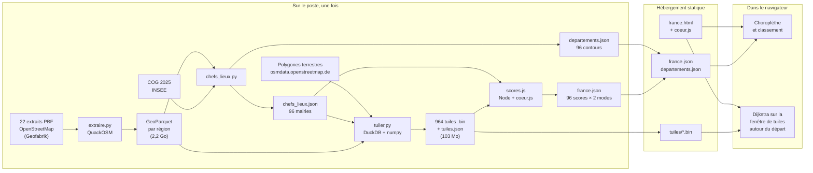
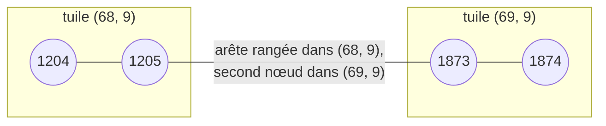
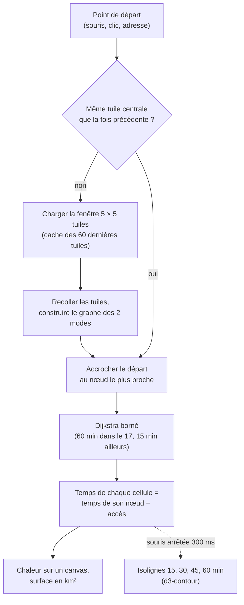

# À portée de vélo — France

Jusqu'où va-t-on à vélo en 15 minutes depuis la mairie de chaque chef-lieu de département ? La carte colore les 96 départements métropolitains par la **surface de terre atteinte** (en km²), selon deux réseaux : les seules pistes et bandes cyclables, ou les pistes complétées par les routes. Un clic sur un département montre le détail autour de sa mairie ; en Charente-Maritime, les temps de trajet suivent la souris en direct sur tout le département.

Tout est calculé **dans le navigateur**, à partir de fichiers statiques : pas de serveur de calcul, pas de base de données, pas d'API de routage. Les données viennent uniquement d'OpenStreetMap et sont figées à une date (extraits Geofabrik des 8 et 9 octobre 2026).

Ce projet dérive d'[À portée de vélo – Marennes-Oléron](https://sit-pmo.github.io/portee-velo/), lui-même inspiré d'[À portée de tram](https://tram.camilleroux.com/) de Camille Roux.

## Sommaire

1. [Ce que mesure la carte](#ce-que-mesure-la-carte)
2. [Vue d'ensemble](#vue-densemble)
3. [Préparer les données](#préparer-les-données)
4. [Le format des tuiles](#le-format-des-tuiles)
5. [Le calcul dans le navigateur](#le-calcul-dans-le-navigateur)
6. [Les scores des 96 chefs-lieux](#les-scores-des-96-chefs-lieux)
7. [Limites connues](#limites-connues)
8. [Refaire les calculs](#refaire-les-calculs)
9. [Sources et crédits](#sources-et-crédits)
10. [Licence](#licence)

## Ce que mesure la carte

**Le score d'un département** est la surface de terre, en km², qu'un cycliste peut atteindre en 15 minutes en partant de la mairie du chef-lieu. On compte les cellules de 100 m × 100 m atteintes ; la mer, les estuaires et les plans d'eau de plus d'un hectare ne comptent pas. Un chef-lieu côtier n'est donc pas pénalisé pour la mer qui l'entoure, seulement pour ce qu'il y a à atteindre sur terre.

Pourquoi une surface plutôt qu'une distance ? Parce qu'elle résume à la fois la densité du réseau, sa continuité et ses obstacles (fleuves sans pont, voies rapides, impasses). Le plafond théorique est le disque parcouru à 20 km/h en ligne droite : 5 km de rayon, soit 78,5 km². Personne ne s'en approche : Paris atteint 34,8 km².

**Deux modes**, comme sur la carte de Marennes-Oléron :

| Mode | Réseau utilisé |
|---|---|
| Pistes + routes (par défaut) | Pistes, voies vertes et bandes, complétées par les routes et chemins. Le temps est majoré de 50 % sur les routes ordinaires, doublé sur les routes secondaires et triplé sur les routes principales sans aménagement, pour tenir compte du trafic et des intersections. |
| Pistes et bandes | Uniquement les aménagements cyclables. Les très courts tronçons de route (moins de 30 m) qui touchent une piste restent praticables : ce sont les traversées de chaussée, qu'OSM classe en route. |

En mode pistes, 19 chefs-lieux sur 96 ont un score nul : aucun morceau de réseau cyclable d'au moins 200 nœuds à moins de 800 m de la mairie.

## Vue d'ensemble



Point clé : **les scores et la page utilisent le même code** (`coeur.js`) et les mêmes tuiles. Un départ posé sur la mairie de Rennes affiche dans la page la surface inscrite dans `france.json`, à l'arrondi près.

## Préparer les données

### 1. Extraire d'OSM ce qui sert (`extraire.py`)

Les 22 extraits régionaux PBF sont convertis en GeoParquet avec [QuackOSM](https://github.com/kraina-ai/quackosm) (DuckDB). On ne garde que quatre familles d'objets, avec tous leurs attributs :

- `highway=*` : le réseau ;
- `amenity=townhall` : les mairies ;
- `natural=water` : retiré de la surface de terre ;
- `boundary=administrative` : les contours des départements et des communes.

Le traitement tient dans 2,5 Go de mémoire, région par région.

### 2. Trouver les mairies des chefs-lieux (`chefs_lieux.py`)

Le chef-lieu de chaque département vient du Code officiel géographique 2025 de l'INSEE. La mairie est l'objet OSM `amenity=townhall` situé dans la commune (contour `admin_level=8` dont le `ref:INSEE` correspond). S'il y en a plusieurs, on prend dans l'ordre : `townhall:type=city`, puis un nom contenant « mairie » ou « hôtel de ville », puis le plus grand bâtiment. Une seule exception : Chartres, sans mairie dans OSM, part d'un point intérieur de la commune.

Le même script écrit les contours simplifiés des 96 départements. Pour trois d'entre eux (Rhône, Loire-Atlantique, Marne), QuackOSM ne reconstruit pas la relation OSM du département : leur contour est reconstitué par l'union de leurs communes.

### 3. Construire le graphe et le découper en tuiles (`tuiler.py`)

**Quelles voies, à quelle vitesse ?** Chaque tronçon reçoit une classe, une vitesse et un sens, selon les règles de la carte de Marennes-Oléron (`classer()` de `build_graph_velo.py`) :

| Classe | Voies |
|---|---|
| 0 — piste ou voie verte | `highway=cycleway`, ou chemin `bicycle=designated` |
| 1 — bande | route portant un aménagement `cycleway=lane`, `track` ou `shared_busway`, ou vélorue |
| 2 — route ou chemin partagé | les autres voies ouvertes aux vélos |
| 3 — route secondaire | `secondary` |
| 4 — route principale | `primary` |

Les autoroutes et voies express (`motorway`, `trunk`), les voies interdites aux vélos (`bicycle=no`), les accès privés, les allées de parking et les trottoirs sans autorisation explicite sont écartés. La vitesse de base est de 20 km/h sur revêtement lisse ; elle descend à 13-17 km/h sur stabilisé ou grave, 11-15 km/h sur pavés, 16 km/h sur les voies partagées avec les piétons et 8 km/h sur sable. Un sens unique se prend à contre-sens à 5 km/h : vélo poussé à pied, plutôt qu'interdit.

**Construire le graphe.** Deux voies OSM sont reliées quand elles partagent un point (au 1e-7 degré près) : c'est ainsi qu'OSM représente les carrefours, alors qu'un pont qui passe au-dessus d'une route n'en partage pas. Les segments de plus de 2 km sont découpés. Pour chaque groupe de tuiles contiguës, on ne garde que la plus grande composante connexe : les bouts de réseau isolés (une piste de parking, une allée privée) disparaissent.

**Découper.** La France est couverte par une grille fixe en degrés, de cellules d'environ 100 m, regroupées en tuiles de 100 × 100 cellules (environ 10 km de côté) :

```
   lon -5,5°, lat 51,5°   (origine, coin nord-ouest)
   ┌──────────┬──────────┬──────────┐
   │ tuile    │ tuile    │          │   tx croît vers l'est
   │ (67, 8)  │ (68, 8)  │   ...    │   ty croît vers le sud
   ├──────────┼──────────┼──────────┤
   │          │ 100 × 100│          │   cellule = 0,00125° × 0,0009°
   │   ...    │ cellules │   ...    │          ≈ 97 m × 100 m à 45° N
   │          │ ≈ 10 km  │          │
   └──────────┴──────────┴──────────┘
```

Seules sont produites les tuiles utiles : toute la Charente-Maritime et 25 km autour (pour le survol), et un carré de 8 km de demi-côté autour de chacune des 95 autres mairies. Soit 964 tuiles, 17,2 millions de nœuds et 103 Mo.

**Préparer chaque cellule.** Pour chaque cellule, la tuile stocke si c'est de la terre (polygones terrestres OSM moins les plans d'eau de plus d'un hectare), le nœud du réseau le plus proche dans chacun des deux modes et la distance à ce nœud. C'est ce qui permet ensuite de colorer une cellule sans chercher son nœud dans le navigateur.

## Le format des tuiles

Une tuile est un fichier binaire compressé (gzip), conçu pour être petit et rapide à décoder. Le navigateur le décompresse avec l'API native `DecompressionStream`, sans bibliothèque.

```
"PVT1"                                 4 octets magiques
en-tête    version, tx, ty, base, n, m, ncx, ncy
nœuds      n longitudes, puis n latitudes (écarts successifs, en 1e-5 degré)
arêtes     m × (a, b, longueur en dm, attributs = classe | sens | vitesse)
cellules   ncx × ncy × (terre, nœud proche × 2 modes, distance × 2 modes)
```

Tous les entiers sont écrits en *varint* (1 octet pour les petites valeurs, plus si besoin), et la plupart en **écarts** avec la valeur précédente plutôt qu'en valeur absolue. Les nœuds sont numérotés tuile par tuile et, dans une tuile, par carré de 1 km : deux nœuds voisins sur le terrain ont des numéros et des coordonnées proches, donc des écarts petits, qui tiennent sur 1 ou 2 octets.

**Recoller les tuiles.** Chaque nœud a un numéro global unique. Une arête appartient à la tuile de son premier nœud ; son second nœud peut être dans une tuile voisine. Quand on charge plusieurs tuiles, il suffit de traduire les numéros globaux en numéros locaux pour retrouver un graphe continu : les routes qui traversent une limite de tuile ne sont pas coupées.



Si la tuile voisine n'est pas chargée, l'arête est écartée : elle est au bord de la fenêtre, hors de portée du calcul (voir plus bas). L'encodeur est `format_tuile.py`, le décodeur miroir `decoderTuile()` dans `coeur.js` ; un test aller-retour vérifie qu'ils restent d'accord.

## Le calcul dans le navigateur

À chaque mouvement de souris (ou au clic sur un département), la page refait tout le calcul en quelques millisecondes :



**La fenêtre de tuiles et la marge.** Le calcul ne porte que sur les 5 × 5 tuiles autour de la tuile du départ, soit environ 50 km de côté. C'est suffisant parce qu'aucune vitesse du modèle ne dépasse 20 km/h : en 60 minutes on parcourt au plus 20 km, et la fenêtre laisse au moins 20 km entre la tuile du départ et son bord.

```
    ┌────┬────┬────┬────┬────┐
    │    │    │    │    │    │
    ├────┼────┼────┼────┼────┤      ≥ 20 km de marge de chaque côté
    │    │    │    │    │    │      de la tuile centrale
    ├────┼────┼────┼────┼────┤
    │    │    │ D  │    │    │      60 min × 20 km/h = 20 km
    ├────┼────┼────┼────┼────┤      → le calcul ne bute jamais
    │    │    │    │    │    │        sur le bord de la fenêtre
    ├────┼────┼────┼────┼────┤
    │    │    │    │    │    │
    └────┴────┴────┴────┴────┘
       une tuile ≈ 10 km
```

Hors de la Charente-Maritime, seules les tuiles à 8 km autour des mairies existent. En 15 minutes on va à 5 km au plus : un départ posé à moins de 3 km de la mairie reste donc dans la zone tuilée (3 + 5 ≤ 8). C'est pourquoi la page n'accepte, hors du 17, que les départs à moins de 3 km d'une mairie, et limite le calcul à 15 minutes.

Tant que la souris reste dans la même tuile centrale, la fenêtre et les graphes sont réutilisés. En changeant de tuile, on recolle une nouvelle fenêtre (les tuiles déjà vues sont en cache) et on précharge en tâche de fond la couronne suivante.

**Accrocher le départ.** Le départ rejoint le nœud du réseau le plus proche, à vol d'oiseau majoré de 30 %, à 16 km/h. On le cherche par anneaux de cellules autour du point, sans dépasser 2 000 m (mode routes) ou 800 m (mode pistes) : au-delà, la page signale qu'il n'y a pas de voie à portée. En mode pistes, le départ ne s'accroche qu'à un morceau de réseau d'au moins 200 nœuds, pour ne pas partir d'un bout de piste isolé de 50 m.

**Dijkstra borné.** L'algorithme de Dijkstra, avec un tas binaire, donne le temps minimal du départ à chaque nœud. Il s'arrête dès que le temps dépasse la limite : il ne parcourt qu'une petite partie de la fenêtre. Chaque tronçon donne deux arcs ; à contre-sens d'un sens unique, l'arc est à 5 km/h.

**Des nœuds aux cellules.** Chaque cellule connaît son nœud le plus proche et la distance à ce nœud (stockés dans la tuile). Son temps est celui du nœud plus le temps d'accès. On n'a donc pas à chercher le nœud de chacune des 250 000 cellules de la fenêtre à chaque mouvement de souris.

**Le dessin.** Les temps sont écrits directement dans les pixels d'un `<canvas>` (un pixel par cellule) que Leaflet place et met à l'échelle sur la carte. Les isolignes ne sont tracées que lorsque la souris s'arrête, car c'est l'étape la plus coûteuse.

## Les scores des 96 chefs-lieux

`scores.js` fait tourner, sous Node, exactement le même code que la page : pour chaque mairie, une fenêtre de 3 × 3 tuiles (15 min = 5 km au plus, plus 2 km d'accès au plus, sous la marge de 10 km), le Dijkstra borné à 15 minutes dans chacun des deux modes, puis la somme de l'aire des cellules de terre atteintes. L'aire d'une cellule dépend de sa latitude (la grille est en degrés) : elle est calculée ligne par ligne.

Résultats (données OSM du 8-9 octobre 2026) :

| | Pistes + routes | Pistes et bandes |
|---|---|---|
| Tête | Paris 34,8 · Strasbourg 32,9 · Grenoble 31,0 · Rennes 30,8 · Lille 29,9 | Paris 21,9 · Grenoble 21,5 · Lyon 15,7 · Strasbourg 15,2 · Rennes 14,3 |
| Médiane | 21,3 km² | 2,1 km² |
| Queue | Mende 8,4 · Bastia 4,9 · Ajaccio 4,3 | 19 chefs-lieux à 0 |

Sur la carte, les départements sont répartis en 7 classes d'effectifs égaux (quantiles), recalculées pour chaque mode : les deux modes n'ont pas du tout la même étendue de valeurs.

**Contrôle de non-régression.** La même chaîne appliquée à l'île d'Oléron reproduit la carte « OSM seul » de Marennes-Oléron à moins d'un point de couverture près (`test/non_regression.js`).

## Limites connues

- **Ni vent, ni relief.** Une montée se fait à la même vitesse qu'une descente : les chefs-lieux de montagne sont flattés.
- **Trafic modélisé grossièrement.** Les majorations par type de route (×1,5, ×2, ×3) sont un choix, pas une mesure. Elles pèsent surtout dans les villes moyennes.
- **OSM tel quel.** Une piste mal décrite (classée en route, sans revêtement) ou absente d'OSM change le score. Les écarts entre départements reflètent aussi l'inégale finesse de la cartographie OSM.
- **Un seul point par département.** La mairie du chef-lieu dit peu de choses du reste du département. Étendre aux 35 000 communes est une piste ouverte.
- **Pas de temps d'attente** aux feux et intersections au-delà des majorations, pas de stationnement, pas de transport du vélo en train.
- **Survol en direct limité au 17**, faute de tuiles ailleurs : les tuiles de toute la France représenteraient plusieurs gigaoctets.
- **Données figées** à la date des extraits ; refaire la chaîne pour les mettre à jour.

## Refaire les calculs

Prérequis : Python 3.11 avec `duckdb`, `quackosm`, `numpy`, `scipy`, `shapely` ≥ 2, `pyproj`, `pyogrio` ; Node ≥ 18. Les 22 extraits PBF régionaux de [Geofabrik](https://download.geofabrik.de/europe/france.html), le fichier `v_departement.csv` du COG de l'INSEE et les [polygones terrestres](https://osmdata.openstreetmap.de/data/land-polygons.html) (`land-polygons-split-4326.zip`) sont placés dans `cache/`.

```sh
# 1. PBF → GeoParquet, une région à la fois (environ 2,5 Go de mémoire)
python extraire.py cache/poitou-charentes-latest.osm.pbf cache/regions/poitou-charentes.parquet --ram-go 2.5

# 2. Mairies des chefs-lieux et contours des départements
python chefs_lieux.py

# 3. Tuiles : la Charente-Maritime entière, et 8 km autour de chaque mairie.
#    Relancer la même commande reprend là où le traitement s'est arrêté.
python tuiler.py --parquet "cache/regions/*.parquet" --departement 17 \
    --chefs-lieux chefs_lieux.json --sortie tuiles --duree-max-min 8

# 4. Scores des 96 chefs-lieux
node scores.js

# 5. Tests (format, recollage, accrochage, chargeur) et non-régression
node --test test/*.test.js
node test/non_regression.js cache/tuiles_nr
```

Pour voir la page, il faut un serveur web (le navigateur bloque le chargement des tuiles depuis un fichier local) :

```sh
python -m http.server
# puis ouvrir http://localhost:8000/france.html
```

| Fichier | Rôle |
|---|---|
| `extraire.py` | PBF → GeoParquet (QuackOSM) |
| `chefs_lieux.py` | COG INSEE + mairies OSM → `chefs_lieux.json`, contours → `tuiles/departements.json` |
| `tuiler.py` | GeoParquet → tuiles de graphe et index `tuiles/tuiles.json` |
| `format_tuile.py` | Encodeur du format de tuile |
| `scores.js` | Scores des 96 chefs-lieux → `tuiles/france.json` |
| `coeur.js` | Cœur de calcul partagé par la page et les scores : décodage, recollage, graphe, Dijkstra, temps par cellule, surface |
| `france.html` | La page (Leaflet, d3) |
| `test/` | Tests Node et contrôle de non-régression |

## Sources et crédits

- Réseau, mairies, contours, plans d'eau et trait de côte : © contributeurs [OpenStreetMap](https://www.openstreetmap.org/copyright), sous licence ODbL ; extraits [Geofabrik](https://download.geofabrik.de/), polygones terrestres [osmdata.openstreetmap.de](https://osmdata.openstreetmap.de/).
- Chefs-lieux : Code officiel géographique 2025, INSEE.
- Fond de carte : Plan IGN (Géoplateforme) ; recherche d'adresses : Géoplateforme, avec repli sur l'API Adresse.
- Bibliothèques : [Leaflet](https://leafletjs.com/), [d3](https://d3js.org/), [QuackOSM](https://github.com/kraina-ai/quackosm), [DuckDB](https://duckdb.org/).
- Inspiration : [À portée de tram](https://tram.camilleroux.com/) de Camille Roux, issu du [NYC Transit Time Cartogram](https://castrio.me/nyc/) d'Anthony Castrio et de sa [déclinaison parisienne](https://github.com/JulesGrandin/paris-temps-transport) par Jules Grandin. Modèle de calcul repris d'[À portée de vélo – Marennes-Oléron](https://github.com/sit-pmo/portee-velo).

## Licence

- **Code** (`*.py`, `*.js`, `france.html`, tests) : [licence MIT](LICENSE), © Aurélien Chaumet. `coeur.js` et les règles de classement des voies reprennent le code d'[À portée de vélo – Marennes-Oléron](https://github.com/sit-pmo/portee-velo), © PETR Pôle Marennes-Oléron, lui aussi sous licence MIT.
- **Données** dérivées d'OpenStreetMap (`tuiles/`, `chefs_lieux.json`, `test/fixtures/`) : [Open Database License (ODbL) 1.0](https://opendatacommons.org/licenses/odbl/1-0/), © contributeurs OpenStreetMap. Toute base de données qui en dérive doit rester sous ODbL et citer OpenStreetMap.
